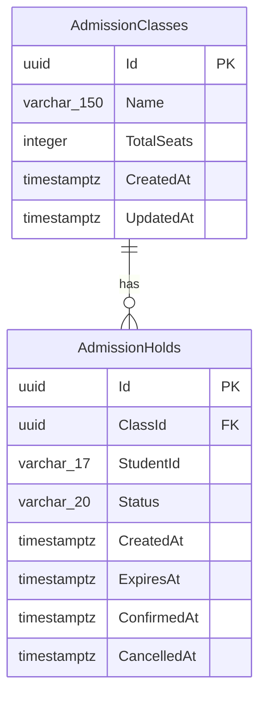

# School Admission System — Database Architecture & EF Core Migration

This document details the database architecture, schema definitions, constraints, indexes, connection configurations, and migration management commands for the School Admission System.

---

## 1. Database Technology and ORM

- **Database Engine**: PostgreSQL 13+ (tested on PostgreSQL 18)
- **Backend Framework**: ASP.NET Core 8 Web API (`net8.0`)
- **Object-Relational Mapper (ORM)**: Entity Framework Core 8 (`Microsoft.EntityFrameworkCore` 8.0.11)
- **Database Provider**: Npgsql (`Npgsql.EntityFrameworkCore.PostgreSQL` 8.0.11)
- **Migration Strategy**: EF Core Code-First Migrations

---

## 2. Entity & Table Descriptions

The system operates on a first-come, first-served admission model without requiring separate student accounts or login tables. Admission seat capacity is managed per class-and-shift combination.

1. **`AdmissionClasses`**:
   - Represents an admission offering for a specific class and shift combination (e.g., *"Class 6 - Morning Shift"*).
   - Each option maintains its own dedicated seat quota (`TotalSeats`).
   - Does not store calculated columns such as held, confirmed, or available seats. These values are derived dynamically from holds.

2. **`AdmissionHolds`**:
   - Represents a temporary seat reservation or confirmed admission application.
   - Identified by student ID from HTTP header `X-Student-Id` (stored as a string of exactly 17 digits).
   - Tracks hold lifecycle: `HELD`, `CONFIRMED`, `EXPIRED`, and `CANCELLED`.
   - Temporary holds expire after a configurable duration (`HOLD_DURATION_SECONDS`, default 600s).

---

## 3. Schema Definitions: Column Names & Data Types

### Table: `AdmissionClasses`

| Column Name | C# Type | PostgreSQL Type | Nullable | Default / Generation | Rules & Description |
|---|---|---|---|---|---|
| `Id` | `Guid` | `uuid` | **No** | `gen_random_uuid()` | Primary Key |
| `Name` | `string` | `varchar(150)` | **No** | — | Required, max 150 chars (e.g. "Class 6 - Morning Shift") |
| `TotalSeats` | `int` | `integer` | **No** | — | Total seat capacity. Must be > 0 |
| `CreatedAt` | `DateTime` | `timestamptz` | **No** | — | UTC creation timestamp |
| `UpdatedAt` | `DateTime` | `timestamptz` | **No** | — | UTC last update timestamp |

### Table: `AdmissionHolds`

| Column Name | C# Type | PostgreSQL Type | Nullable | Default / Generation | Rules & Description |
|---|---|---|---|---|---|
| `Id` | `Guid` | `uuid` | **No** | `gen_random_uuid()` | Primary Key |
| `ClassId` | `Guid` | `uuid` | **No** | — | Foreign key referencing `AdmissionClasses.Id` |
| `StudentId` | `string` | `varchar(17)` | **No** | — | Student identifier. Must be exactly 17 digits |
| `Status` | `AdmissionHoldStatus` (enum) | `varchar(20)` | **No** | — | Status string: `'HELD'`, `'CONFIRMED'`, `'EXPIRED'`, or `'CANCELLED'` |
| `CreatedAt` | `DateTime` | `timestamptz` | **No** | — | UTC creation timestamp |
| `ExpiresAt` | `DateTime` | `timestamptz` | **No** | — | UTC expiration timestamp |
| `ConfirmedAt` | `DateTime?` | `timestamptz` | Yes | `NULL` | UTC confirmation timestamp |
| `CancelledAt` | `DateTime?` | `timestamptz` | Yes | `NULL` | UTC cancellation timestamp |

---

## 4. Entity-Relationship Diagram



### Relationship Rules
- **Cardinality**: `AdmissionClasses (1) <----> (Many) AdmissionHolds`.
- **Referential Integrity**: Every hold must reference a valid `AdmissionClass.Id`.
- **Deletion Behavior**: `ON DELETE RESTRICT` (`DeleteBehavior.Restrict`). An `AdmissionClass` record cannot be deleted if associated hold history exists.

---

## 5. Constraints and Indexes

### 1. Check Constraints

| Table | Constraint Name | PostgreSQL Expression | Purpose |
|---|---|---|---|
| `AdmissionClasses` | `CK_AdmissionClasses_TotalSeats_Positive` | `"TotalSeats" > 0` | Guarantees seat capacity is strictly positive. |
| `AdmissionHolds` | `CK_AdmissionHolds_StudentId_Format` | `"StudentId" ~ '^[0-9]{17}$'` | Enforces exactly 17 numeric digits. |
| `AdmissionHolds` | `CK_AdmissionHolds_Status_Valid` | `"Status" IN ('HELD', 'CONFIRMED', 'EXPIRED', 'CANCELLED')` | Enforces valid status values stored as strings. |

### 2. Indexes

| Table | Index Name | Columns | Type / Filter | Purpose |
|---|---|---|---|---|
| `AdmissionClasses` | `PK_AdmissionClasses` | `Id` | Primary Key (B-tree) | Entity identification |
| `AdmissionHolds` | `PK_AdmissionHolds` | `Id` | Primary Key (B-tree) | Entity identification |
| `AdmissionHolds` | `IX_AdmissionHolds_ClassId_Status` | `(ClassId, Status)` | B-tree | Optimizes seat calculations by class and status |
| `AdmissionHolds` | `IX_AdmissionHolds_Status_ExpiresAt` | `(Status, ExpiresAt)` | B-tree | Optimizes hold expiration checks and seat release |
| `AdmissionHolds` | `IX_AdmissionHolds_StudentId_Active` | `(StudentId)` | **Unique Partial Index**<br>`WHERE "Status" IN ('HELD', 'CONFIRMED')` | **Guarantees at database level that a student can have at most ONE active application across all admission classes.** |

> [!IMPORTANT]
> **Why a partial index instead of a standard unique index?**
> A student can only have one *active* application (`HELD` or `CONFIRMED`). However, when an earlier hold is `EXPIRED` or `CANCELLED`, the student is permitted to apply again. A standard unique index on `StudentId` would permanently block repeated attempts, whereas this partial index strictly constrains active holds while retaining historical records.

---

## 6. Seat Calculation Logic (Query Design)

Seat counts are not stored as static counter columns; they are computed dynamically to prevent concurrency drift:

- **Held Seats (`heldSeats`)**:
  ```sql
  SELECT COUNT(*) FROM "AdmissionHolds"
  WHERE "ClassId" = @ClassId
    AND "Status" = 'HELD'
    AND "ExpiresAt" > (NOW() AT TIME ZONE 'UTC');
  ```
- **Confirmed Seats (`confirmedSeats`)**:
  ```sql
  SELECT COUNT(*) FROM "AdmissionHolds"
  WHERE "ClassId" = @ClassId
    AND "Status" = 'CONFIRMED';
  ```
- **Available Seats (`availableSeats`)**:
  $$\text{availableSeats} = \text{TotalSeats} - (\text{heldSeats} + \text{confirmedSeats})$$

---

## 7. Configuration & Connection Strings

### Configuration Hierarchy in ASP.NET Core
In ASP.NET Core, `builder.Configuration.GetConnectionString("DefaultConnection")` resolves keys in the following priority order:
1. Environment variables (`ConnectionStrings__DefaultConnection`)
2. `appsettings.{Environment}.json` (e.g. `appsettings.Development.json`)
3. `appsettings.json`

### Outside Docker (Local Development)
In `appsettings.Development.json`:
```json
{
  "ConnectionStrings": {
    "DefaultConnection": "Host=localhost;Port=5432;Database=school_admission_db;Username=postgres;Password=YOUR_POSTGRES_PASSWORD"
  }
}
```

### Inside Docker Compose
In Docker Compose, use container networking with service name `db` via environment variable:
```yaml
services:
  api:
    environment:
      - ConnectionStrings__DefaultConnection=Host=db;Port=5432;Database=school_admission_db;Username=postgres;Password=postgres
```
*(Notice the double underscore `__` which maps to `:` in ASP.NET Core configuration paths).*

> [!NOTE]
> Database passwords must not be committed to source control. `appsettings.Development.json` is ignored via `.gitignore`, and a template `appsettings.Development.json.example` is provided for reference.

---

## 8. EF Core Migration Commands

All migration commands are executed using the .NET CLI `dotnet ef` tool against `backend/SchoolAdmissionAPI`.

### 1. Create a New Migration
When entity models or DbContext configurations change:
```bash
dotnet ef migrations add <MigrationName> --project backend/SchoolAdmissionAPI --output-dir Data/Migrations
```
*Example:*
```bash
dotnet ef migrations add AddStudentNotes --project backend/SchoolAdmissionAPI --output-dir Data/Migrations
```

### 2. Apply Migrations to PostgreSQL
Apply all pending migrations to the configured database:
```bash
dotnet ef database update --project backend/SchoolAdmissionAPI
```

### 3. List All Migrations
View all migrations and check which ones have been applied:
```bash
dotnet ef migrations list --project backend/SchoolAdmissionAPI
```

### 4. Roll Back to an Earlier Migration
To revert changes back to a previous migration state:
```bash
dotnet ef database update <TargetMigrationName> --project backend/SchoolAdmissionAPI
```
*To roll back all migrations:*
```bash
dotnet ef database update 0 --project backend/SchoolAdmissionAPI
```
*To remove the latest unapplied migration file:*
```bash
dotnet ef migrations remove --project backend/SchoolAdmissionAPI
```

### 5. Generate Idempotent SQL Scripts
Generate raw SQL scripts for inspection or automated CI/CD pipeline deployments:
```bash
dotnet ef migrations script --idempotent --project backend/SchoolAdmissionAPI --output Data/Migrations/migration_script.sql
```

---

## 9. Design Assumptions

1. **UUID Generation**: Configured `gen_random_uuid()` as the database default value for `Id` in both tables. This allows both EF Core client-side generation and direct SQL insertions to receive valid UUIDs.
2. **StudentId Format**: Implemented a POSIX regex check constraint `"StudentId" ~ '^[0-9]{17}$'` in PostgreSQL to enforce exactly 17 numerical digits at the schema level.
3. **No Students Table**: As mandated by the assignment requirements, no separate `Students` or `Shifts` tables are created. Each admission class record represents a combined class and shift entity.
